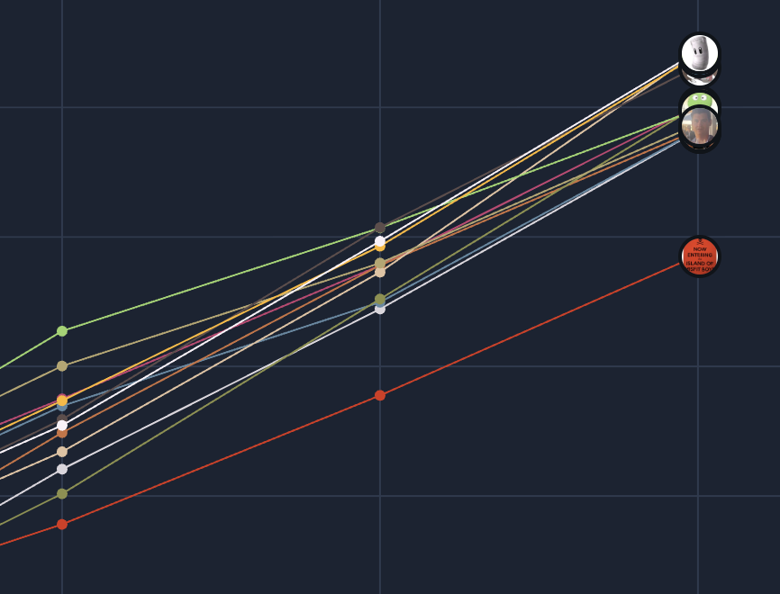
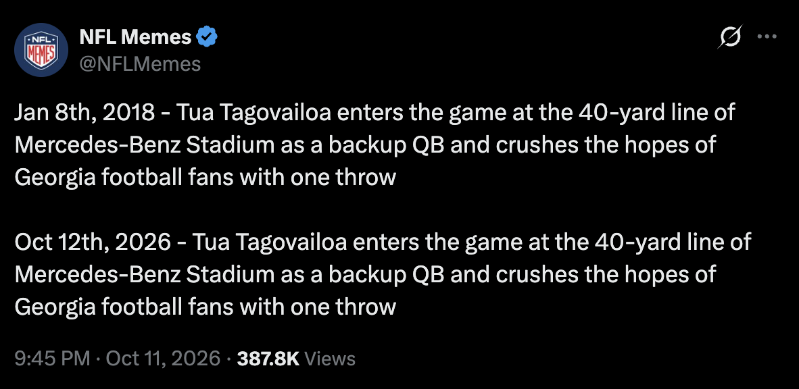
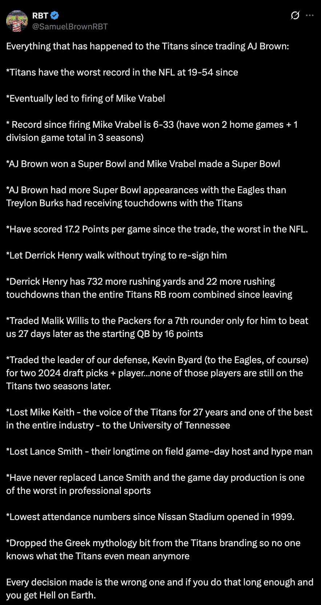
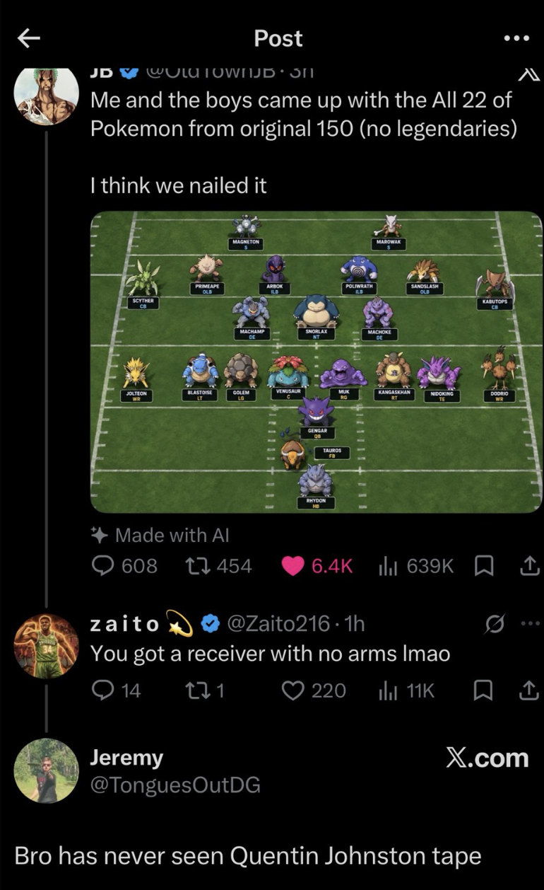

Mornin! What a week amiright. Some thoughts:

- Mandy and I are mortal after all. Looking through Points/Power Rankings/ETEW graphs below, you can see how much closer the whole league got this week. Just when I was about to start bragging that it was a 2 man league. And now Mandy and I play each other this week. Also Catt wants everyone to know he has scored the most poins now. Sick dude.
- Half the league is 2-3. 5th place is tied with 11th. Last place is 1 game out of a playoff spot. That's some real pickle shit.
- David is pulling an all-time Ryan as has been pulling away with the least Points Against. It's just getting crazy now.

- In real football that felt like the pickle, the NFC East won 0 games this week despite 1 team playing an 0-4 Bucs starting an undrafted rookie backup QB, 1 team took the lead with 8 seconds left in the game, and the other 2 teams played each other. 0 wins. Unreal.

Now let's talk about the new additions to this page:

- When you hover over a team in one of the standings/points graphs now, the line will be bolded so you can easily see the whole path.
- As promised, there's a whole new Draft Analysis section I added, and I need to explain how it works. Here's what you need to know:
1. FPOR = Fantasy Points Over Replacement. This is a player's Points Per Game minus the PPG of a "replacement-level" player at their position (in our league's case, that would be the QB24, RB24, WR24, TE12, K12, and DEF12). Basically a measure of how good they are compared to the worst starter/best backup.
2. When you plot FPOR by draft pick, you can fit a trend line to show Expected Fantasy Points. The thinking there is that earlier draft picks are *supposed* to have higher FPORs (the reason they get picked first).
3. If you take a player's FPOR minus their Expected Fantasy Points, you get their FPOE (Fantasy Points Over Expected). FPOE is the best metric to measure how much value you got from a particular draft pick. It takes into account the player's performance, the average league performance at that position, and the spot they were taken.
4. There is also a way to toggle injuries off or on for this metric. When off, that gives you the true value, ignoring games when a player sat out, because in theory that means you are starting a "replacement" player instead. When injuries are on, the data changes to punish players/draft picks for missing games due to injury. This one will probably be tied more closely to the standings, but as the season goes on you'll see players who are out for the year continue to drop to the bottom of FPOE here, so it will get skewed.

Enjoy!

https://x.com/Colin_McT/status/2107913650669318394?s=20

https://x.com/cathyrusson/status/2108602033507033538?s=20

https://x.com/BostonConnr/status/2108578286385181161?s=20

https://x.com/ghetto_gronk/status/2108975430485319811?s=20

https://x.com/BenchwarmerBran/status/2108948078929825808?s=20

https://x.com/BillyM_91/status/2109423549379416180?s=20

https://x.com/a_coleman25/status/2109492041088377051?s=20

https://x.com/burgermanders/status/2109611818134237615?s=20

Thankfully none of us have Titans fans in our lives (maybe), but shoutout this guy for roasting the entire organization.

https://x.com/barstoolsports/status/2110028527051702335?s=20

https://x.com/Koll_0ne/status/2109820158009307271?s=20

Welp
https://x.com/RapSheet/status/2110057991164567899?s=20

Ok this last section is for Michael's eyes only. NFL Twitter has finally embraced Pokemon as football players, and I don't understand any of it. I saved these tweets just for our special little Poke friend.
https://x.com/OldTownJB/status/2108255031028015484?s=20

https://x.com/Moms_Fav_Ninja/status/2108926727942513090?s=20

https://x.com/Novig/status/2109708992503222340?s=20

Update: someone made a website where you can draft teams of Pokemon and it will tell you what their record will be. I expect we won't hear from Michael again until 2028.
https://x.com/ColeThereum/status/2108595809373601797?s=20
