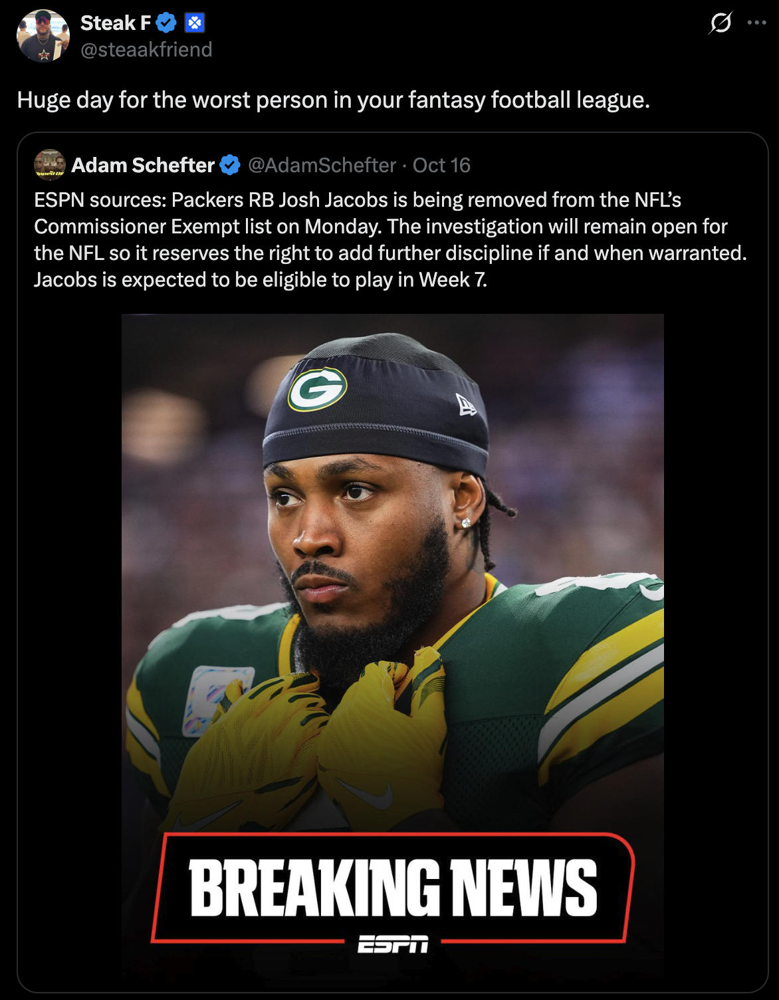
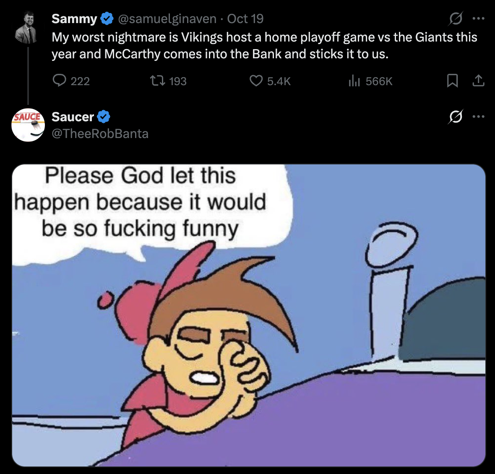
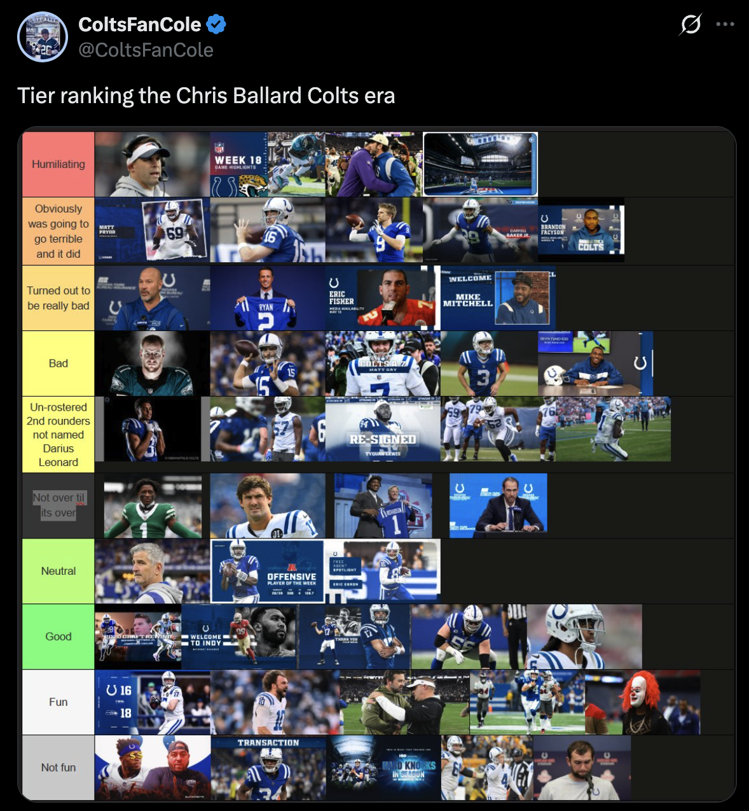
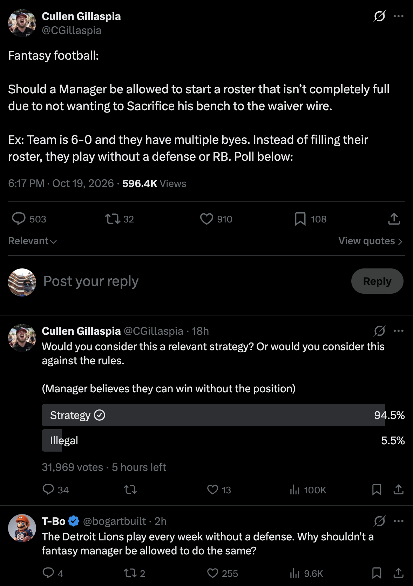

Sup fellas! Not too much to say this week except that I saw that this was the first week since 2009 where not a single player scored 30+ (in standard scoring, but even with our rules too). Crazy stuff. No new features this week, but my team sucks, the Colts suck, everyone's injured now and that sucks, anybody who plays against David sucks, and the NFC East sucks.

https://x.com/NFL_DovKleiman/status/2109779153708855663?s=20

https://x.com/NickLewis37/status/2110899081681768448?s=20

CC @ David

https://x.com/Wiggs4Pres/status/2111890368874897889?s=20

https://x.com/chellgod/status/2111961222224474361?s=20

Woah.
https://x.com/JohnToddNFL/status/2111917655259304144?s=20

Also woah.
https://x.com/tylershough2/status/858696996965699585?s=20

https://x.com/cassiusjaeare/status/2112562235067314573?s=20

https://x.com/WhitePepperESQ/status/2111985671791407536?s=20

https://x.com/Stuckey2/status/2111955692177215863?s=20

Thankfully the Rams fans didn't spend all week calling their last kicker fat and gross and they can just re-sign him now
https://x.com/nickbateman33/status/2112319353488019907?s=20